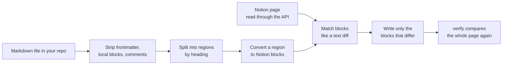

# notion-sync

Sync specific markdown files on your machine to their Notion pages, one section at a time.

You pick a file, and the file's frontmatter names the page it belongs to. When you run a command, the page is updated to match the file. Nothing runs in the background. The files can be anywhere on your machine: no git repository is needed, though keeping them in one gives you history.

The sync goes one way: the local file is the source and Notion is the destination. Edits made on the page are never pulled back into the file. They are reported as differences, and you decide which side is right.

It writes only the text of the page. It leaves everything else on the page alone: comment threads, reviewer properties, and sections people edit by hand.

It is plain Python 3 with nothing to install, plus two Claude Code skills so Claude can set it up, write documents for it, and run it for you.

## Contents

- [How it works](#how-it-works)
- [Set up](#set-up)
  - [Before you start](#before-you-start)
  - [1. Get the tool](#1-get-the-tool)
  - [2. Get the client secret](#2-get-the-client-secret)
  - [3. Authorize your Notion account](#3-authorize-your-notion-account)
  - [4. Check the install](#4-check-the-install)
  - [5. Try it on a real page](#5-try-it-on-a-real-page)
  - [6. Install the Claude Code skills](#6-install-the-claude-code-skills)
  - [Update or sign out](#update-or-sign-out)
- [Notion conventions in plain markdown](#notion-conventions-in-plain-markdown)
  - [Why conventions](#why-conventions)
  - [Quick reference](#quick-reference)
  - [Callouts](#callouts)
  - [Toggles](#toggles)
  - [Local-only content](#local-only-content)
  - [Page-owned sections](#page-owned-sections)
  - [Links between documents](#links-between-documents)
  - [Diagrams and code](#diagrams-and-code)
  - [Headings, tables and prose](#headings-tables-and-prose)
  - [What is not supported](#what-is-not-supported)
- [Prepare a document](#prepare-a-document)
- [Publish a document](#publish-a-document)
- [Work with Claude Code](#work-with-claude-code)
  - [The two skills](#the-two-skills)
  - [Prompts to copy](#prompts-to-copy)
- [Command reference](#command-reference)
- [Safety guards](#safety-guards)
- [Troubleshooting](#troubleshooting)
- [Files](#files)

## How it works

Your local file owns the text. Notion owns everything around it.



The steps, in order:

1. **Read and clean.** The script reads the markdown and removes what must never publish: the YAML frontmatter, anything between `<!-- local:start -->` and `<!-- local:end -->`, and `%%Obsidian comments%%`.
2. **Resolve links.** A link to another local document becomes a link to that document's Notion page, using the target's own `published_url`. A link whose target is still waiting for a page is reported as a blocker rather than published dead.
3. **Split into regions.** Each heading and the prose under it is a region you can address by name, such as `"## Risks"`, or `"## Parent > ### Details"` when a name repeats.
4. **Convert.** Only a fixed subset of markdown is understood (see [conventions](#notion-conventions-in-plain-markdown)). Anything else stops the run instead of being dropped silently.
5. **Diff against the live page.** The script reads the page's blocks and matches them to the converted ones the way a text diff matches lines. An identical block is left alone. A reworded block of the same type is rewritten in place through its own ID. Only blocks with no match are created or deleted.
6. **Keep what survives.** Unchanged and reworded blocks keep their IDs, so their comment threads stay attached.
7. **Verify.** `verify` compares the whole managed body of the document with the page and exits nonzero if anything is out of step.

Run it a second time with no changes and nothing is written.

## Set up

Do this once per person. It takes about ten minutes.

### Before you start

You need:

- **Python 3.9 or newer.** Check with `python3 --version`. There is nothing to `pip install`.
- **git**, to clone this tool and pull updates. Your own documents do not need to be in git.
- **A Notion account in the workspace** that holds the pages you will publish to, with permission to edit them.
- **The client secret**, from whoever runs this tool for the team. It lives in the team password manager. It is the only shared secret, and you will paste it into your own terminal once.
- **Claude Code**, if you want Claude to run the sync for you. The scripts work without it.

### 1. Get the tool

Clone this repository somewhere permanent. Your documents live wherever you keep them; this checkout holds only the tool.

```bash
git clone https://github.com/yosia1203/notion-sync.git ~/dev/notion-sync
```

### 2. Get the client secret

Copy it from the password manager. Do not save it in a file, commit it, or paste it into chat or into Claude. The tool never writes it to disk.

### 3. Authorize your Notion account

This gives the tool a token that belongs to you, so page history shows your name against your edits.

```bash
cd ~/dev/notion-sync
python3 scripts/notion_auth.py url
```

Open the printed link in your browser, approve, and grant access to the pages or database you will publish to.

The browser then fails to load a page at `http://localhost/?code=...`. That is expected: the authorization code is in the address bar. Copy the whole address and run:

```bash
python3 scripts/notion_auth.py exchange '<the address you copied>'
```

Paste the client secret when prompted. Nothing is echoed. (Or set `NOTION_CLIENT_SECRET` in that shell first.)

The token is saved to `~/.config/notion-sync/notion_token.json`. Only you can read it and it sits outside any project folder. The scripts never print it.

An authorization code is single-use and short-lived. If `exchange` fails with `invalid_grant`, run `url` again and approve again.

### 4. Check the install

These tests run offline and need no token. They confirm the scripts work on your machine.

```bash
python3 -m unittest discover -s scripts -p 'test_*.py'
```

You should see `OK`.

### 5. Try it on a real page

The first live check should be read-only. Pick a document that already has a Notion page and a `published_url` in its frontmatter (see [Prepare a document](#prepare-a-document)), then run:

```bash
python3 scripts/notion_publish.py manual /path/to/your-repo/docs/my-document.md
```

A list that classifies each region as matching, differing, missing, manual or blocked means the connection works. Nothing was written.

If you get an error instead, see [Troubleshooting](#troubleshooting).

### 6. Install the Claude Code skills

Two skills in `.claude/skills/` teach Claude how to use the tool. Link them into your user skills so every project has them, and so `git pull` updates them:

```bash
mkdir -p ~/.claude/skills
```

```bash
ln -s ~/dev/notion-sync/.claude/skills/notion-sync ~/.claude/skills/notion-sync
```

```bash
ln -s ~/dev/notion-sync/.claude/skills/writing-for-notion ~/.claude/skills/writing-for-notion
```

Start a new Claude Code session. Ask "what skills do you have for Notion?" and both should appear. [Work with Claude Code](#work-with-claude-code) says what each does.

### Update or sign out

Update the tool and the skills together:

```bash
cd ~/dev/notion-sync && git pull
```

To sign out, delete the token. Run `notion_auth.py url` and `exchange` again to sign back in.

```bash
rm ~/.config/notion-sync/notion_token.json
```

## Notion conventions in plain markdown

### Why conventions

Notion has blocks that markdown cannot express: callouts, toggles, sections that people edit by hand, and text that should stay on your machine. Standard markdown has no syntax for them.

So the tool reads a small set of conventions. Every one is chosen to degrade gracefully: in GitHub, Obsidian or any plain viewer the file still reads as ordinary markdown. HTML comments are invisible there, and a callout is a normal blockquote. Only this tool gives them their Notion meaning.

It also means the converter is not a general markdown importer. It understands a fixed subset and refuses the rest. A refusal is the tool telling you a construct would not survive the trip, and it is better than a page that quietly lost content.

### Quick reference

| You want in Notion | Write in markdown | In a plain viewer |
|---|---|---|
| A callout | A blockquote that starts with an emoji | A quote beginning with the emoji |
| A toggle heading | `## Heading <!-- toggle -->` | An ordinary heading |
| A toggle block | `<!-- toggle-block: Title -->` ... `<!-- toggle-block:end -->` | The content, without the toggle |
| Underlined text | `==text==` | Highlighted in Obsidian, literal elsewhere |
| A section people edit in Notion | `## Heading <!-- manual -->` | An ordinary heading |
| Text that stays in the repo | `<!-- local:start -->` ... `<!-- local:end -->` | Visible only in the source |
| A repo-only note | `%%note%%` | Hidden in Obsidian, literal elsewhere |
| A diagram | A fenced `mermaid` block | A code block |
| A link to another published document | A relative path to its `.md` file | A working relative link |

### Callouts

Start a blockquote with an emoji. The emoji becomes the callout's icon. Use one to surface a key decision or a warning. A blockquote that does not start with an emoji stays a plain quote block.

```markdown
> ⚠️ This changes the response shape. Clients must update before the rollout.
```

### Toggles

A **toggle heading** hides a whole section. Add `<!-- toggle -->` to the heading. The section is everything up to the next heading at the same or a higher level, and it goes inside the toggle. Use it when readers can skip the section on a first pass.

```markdown
## Alternative solution <!-- toggle -->

Why we did not choose this.
```

A **toggle block** hides a smaller piece that does not need its own heading, such as an example. Wrap it in a marker pair. The text after the colon is the toggle's title.

```markdown
<!-- toggle-block: Example request and response -->

The body of the example goes here.

<!-- toggle-block:end -->
```

Limits: a toggle block cannot sit inside another toggle block, cannot contain a heading, and must be closed. A toggle heading nests only two levels deep. The page's main path should still read properly with every toggle closed.

### Local-only content

Anything between these markers is removed before every comparison and write. Use it for review notes, the audience you wrote for, or drafting scaffolding.

```markdown
<!-- local:start -->
Audience: engineers who will implement this. They know the old flow.
<!-- local:end -->
```

A local block can sit above the first section, inside a section, or around a whole section. Always close it: an unbalanced marker is refused rather than silently hiding the rest of the document.

For a short note, wrap it in `%%double percent signs%%`. This works for a span within a line, a whole line, or several lines. Inside a code fence it stays literal code.

### Page-owned sections

Some content only exists in Notion: an image, an embed, a table someone maintains by hand. Mark that section's heading `<!-- manual -->`.

```markdown
## Benchmark screenshots <!-- manual -->

<!-- local:start -->
Three screenshots of the load test, added in Notion by hand.
<!-- local:end -->
```

The script then owns nothing in that section or its subsections. `verify` reports when the page and the local file differ there, and `apply` never writes it. Describe the intended content inside a local block, as above, so a reader of the file knows what lives on the page.

### Links between documents

Write a link to another document as a relative path to its file. The script swaps it for the target's Notion address using the `published_url` in the target's frontmatter.

```markdown
See [the lint pipeline](../tsd/lint-pipeline.md) for the rules.
```

The target's frontmatter decides what happens:

| Target's frontmatter | Result |
|---|---|
| `published_url: https://...` | The link points at the page. |
| `published_url:` present but empty | A blocker. The target is waiting for its page, and linking now would publish a dead reference. Publish that page first. |
| no `published_url` field at all | The link becomes plain text. Use this for documents that will never have a page, so they do not fail verification forever. Name the thing in the sentence, so the page still says what the reader is being sent to. |

A markdown anchor such as `#some-heading` has no Notion destination, so do not rely on a heading slug working on the page.

### Diagrams and code

Put every sequence, state machine, decision path or pipeline in a fenced `mermaid` block. Notion renders it. Quote punctuation in labels, choose one direction, avoid hard-coded styling, and split a diagram that gets hard to read in a page column. An ASCII flow belongs in an ordinary code block.

Code fences need a language from this list, or no tag for plain text: `yaml`, `json`, `go`, `bash`, `shell`, `text`, `plain text`, `mermaid`, `makefile`, `diff`, `markdown`, `javascript`. An unknown tag is refused instead of silently losing highlighting. Start every fence in column one. A fence inside a list item, or indented, reaches the page as literal backticks, so it is refused.

To show a fence inside a fence, make the outer one longer, as the examples in this README do.

### Headings, tables and prose

- **Headings.** Start with a body title heading (`#`). After it, sections use `##` (or `#` if the document's template does; the script reads the depth from the second heading). Use `####` for a distinct topic under a `###`. `#####` and deeper is refused.
- **Tables.** Pipe tables with a header row. Cells hold rich text only: no lists, code fences or nested blocks. Empty cells and escaped pipes (`\|`) are kept.
- **Lists.** Bullets, numbered lists, `- [ ]` checkboxes, and nested items.
- **Inline.** Bold, italic, `code`, ~~strikethrough~~, links, and `==underline==`.
- **Dividers.** `---` inside the body.
- **Do not hard-wrap prose.** Keep each paragraph on one source line. Notion limits one rich-text segment to 2,000 characters, so split an oversized table or request into smaller regions.

### What is not supported

The script refuses, rather than guesses, on:

- images (they need a manual section or a separate upload)
- footnotes and HTML tags
- headings deeper than `####`
- indented code fences and unclosed fences
- a toggle inside a toggle, or a heading inside a toggle block
- unclosed local or toggle markers

Content that exists on the page but that the converter cannot write, such as an embed or a synced block, must stay in a `<!-- manual -->` section. Do not imitate it with HTML in a managed section.

## Prepare a document

A document can be synced only when it has a Notion page and says where it is.

1. Create the page once, by importing the markdown into Notion. Import creates a new page each time, so do it once per document. Import does not apply the cleaning above, so make a copy with frontmatter, local blocks and `%%comments%%` removed first.
2. Put the page's address in the document's frontmatter:

   ```yaml
   ---
   title: My document
   published_url: https://www.notion.so/...
   ---
   ```

   Frontmatter itself is never published. `published_url` is also what other documents' links resolve to.
3. Start the body with a title heading (`#`), then the sections.

Frontmatter fields the script reads: `published_url`, and `imported: true` for prose that is someone else's wording. The script never writes frontmatter. To track when you last synced, record it yourself.

**Authored or imported.** An authored document's text is yours and publishes outward. A document marked `imported: true` carries another team's wording: differences resolve toward the page, and unsupported syntax is kept literally with a warning instead of refusing. Do not use the tool to overwrite imported prose.

## Publish a document

Work one section at a time. A long document is too much to verify in a single write.

```bash
# 1. See where the document and page differ. Read-only.
python3 scripts/notion_publish.py verify docs/my-document.md

# 2. Classify every region as matching, differing, missing, manual or blocked. Read-only.
python3 scripts/notion_publish.py manual docs/my-document.md

# 3. Preview one region's write. Nothing is written.
python3 scripts/notion_publish.py plan docs/my-document.md "## Risks"

# 4. Write it.
python3 scripts/notion_publish.py apply docs/my-document.md "## Risks"

# 5. Compare the whole document again.
python3 scripts/notion_publish.py verify docs/my-document.md
```

Repeat 3 and 4 for each region that differs. The sync is complete only when step 5 passes. Then look at the sections marked manual: they are the page's, so the script has not touched them. Tell whoever owns them what changed.

A zero exit from `verify` means the managed body matches. It says nothing about page properties, the page title, comments, or edits made while it ran.

Two properties stay out of this tool's reach by design:

- **Reviewer properties** (status, reviewers, review date and similar) are never written. Only the page body is.
- **The page title** cannot be written. To rename a page, change the title heading in the document, `apply` it, then edit the title in Notion by hand. The [publishing reference](.claude/skills/writing-for-notion/references/publishing.md) has the steps.

## Work with Claude Code

### The two skills

| Skill | Use it for |
|---|---|
| `notion-sync` | Operating the tool: checking the connection, walking you through setup, running verify, plan and apply, reading and answering comments, explaining a refusal. It asks before each write and never takes a loss flag on its own. |
| `writing-for-notion` | Writing a document so it converts cleanly: the supported markdown, the conventions above, and the full publishing procedure. |

Claude loads a skill when your request matches its description, so you rarely need to name one. Setup is in [step 6](#6-install-the-claude-code-skills).

### Prompts to copy

Replace the paths and names. Claude will ask for the checkout location if you leave it out.

**First-time setup**

```text
Set up the Notion sync for me. The tool is in ~/dev/notion-sync. Check whether I am already signed in, and if not, walk me through the sign-in. I will type the client secret myself in my own terminal, so do not ask me for it here. When it works, run a read-only check against docs/my-document.md.
```

**Sync a document**

```text
Sync docs/my-document.md to its Notion page. Run verify and manual first and tell me which regions differ. Then show me the plan for each differing region and wait for my yes before you apply it. Do not use any --allow flag without asking. When you are done, run verify again and list the page-owned sections I need to check.
```

**Sync one section**

```text
In docs/my-document.md, publish only the "## Risks" section to Notion. Show me the plan first.
```

**Review comments**

```text
List the open comment threads on the Notion page for docs/my-document.md and tell me which are waiting on me. Draft a reply to each one, show me the wording, and post nothing until I approve it.
```

**Write a new document for Notion**

```text
Write a design document for <topic> in docs/<name>.md so it publishes cleanly to Notion. Use only the supported markdown and the Notion conventions from the writing-for-notion skill. Put the diagrams in mermaid blocks. Put anything that cannot convert in a manual section. Do not publish it yet.
```

**Understand a refusal**

```text
The sync refused with this message: <paste it>. Explain what it means, what would be lost if I forced it, and the safest way to fix the document or the page.
```

## Command reference

All commands are `python3 scripts/notion_publish.py <command> <doc.md> ...`.

| Command | Does |
|---|---|
| `verify <doc>` | Compares the whole managed body. Add `--with-comments` to also list open threads. |
| `manual <doc>` | Classifies every region. Read-only. |
| `coverage <doc>` | Lists page blocks that no section accounts for. |
| `plan <doc> "<heading>"` | Shows what a region write would create and delete. Writes nothing. |
| `apply <doc> "<heading>"` | Replaces that region, block by block. |
| `insert <doc> "<heading>" "<before>"` | Creates a section the page lacks. Previews unless you add `--yes`. |
| `drop <doc> "<heading>"` | Removes a section the document no longer has. Previews unless you add `--yes`. |
| `comments <doc>` | Lists every open thread on the page as a work list. |
| `reply <doc> "<discussion>" "<text>"` | Answers one thread. Previews unless you add `--yes`. |

The heading `@preamble` selects the prose between the title and the first section.

| Flag | Allows |
|---|---|
| `--preamble` | Replace only a section's introduction, not its subsections. |
| `--allow-flatten` | A conversion the script reports as lossy. Never a nested page or database. |
| `--allow-link-loss` | A write that removes or leaves unresolved links, as reported. |
| `--allow-comment-edit` | Rewriting a block that carries comments. A thread on a highlighted phrase leaves the page. |
| `--with-comments` | `verify` also reads every open thread. Slow: about four minutes for 195 blocks. |
| `--yes` | Executes the previewed `insert`, `drop` or `reply`. |

Resolving a comment thread is not on the list because Notion's API cannot do it. `comments` shows only open threads; resolving one in Notion removes it from the list.

`scripts/notion_sync.py check|apply <doc>` is a narrower tool. It finds code blocks on the page whose whitespace was damaged by pasting and restores them from the local file. It touches nothing else and pairs a block with a fence only when the two match once whitespace is ignored.

## Safety guards

The script refuses, and tells you why, when a write would:

- replace a block that carries comments (unless `--allow-comment-edit`)
- remove or lose a link (unless `--allow-link-loss`)
- flatten a structure it cannot reproduce (unless `--allow-flatten`)
- delete a nested page or database
- write into a `manual` section, or replace one through its parent
- use a heading name that matches more than one place, without its parent path
- convert markdown it does not recognise

Refusals begin with `REFUSING:`. Read the message and fix the document or the page. Do not reach for a flag until you know what it would lose.

**Comments and rewrites.** A comment thread belongs to one block. If a reviewer commented on the whole block, a rewrite keeps the thread. If they highlighted a phrase and commented on it, which is the usual case, a rewrite of that block makes the thread leave the page: it stays open but is shown nowhere and no listing returns it. The script cannot tell the two kinds apart, so it refuses to rewrite a commented block unless you pass `--allow-comment-edit`. Have the reviewer resolve the thread first, or accept the loss knowingly.

## Troubleshooting

| You see | Do this |
|---|---|
| No such file `notion_token.json` | Run the [setup](#set-up) steps. |
| `invalid_grant` on `exchange` | The code was used or expired. Run `url` and approve again. |
| A 404 or `object_not_found` from the API | Most likely the page was not shared with your authorization. Run `url` again and grant access to it. |
| `verify` fails on an unresolved link | The linked document has an empty `published_url`. Publish that page first, or remove the link. |
| `verify` reports a manual section differs | Expected. The page owns it. Tell its owner what changed. |
| `REFUSING: ambiguous ... heading` | Qualify the name with its parent: `"## Parent > ### Details"`. |
| A paragraph keeps differing after `apply` | Run `plan` on it. The page may hold a block type the converter cannot write, such as a synced block. Mark the section `<!-- manual -->`. |
| `WRITE OUTCOME UNKNOWN` | A request may or may not have landed. Run `verify` before you retry. Repeating `apply` is safe because unchanged blocks are left alone. |
| An HTTP error that retries | The script retries a failed request four times. If it still fails, wait and rerun. |

## Files

| Path | Purpose |
|---|---|
| `scripts/notion_auth.py` | One-time OAuth sign-in |
| `scripts/notion_publish.py` | Verify, plan and apply, comments |
| `scripts/notion_sync.py` | Repair whitespace in code blocks |
| `scripts/test_*.py` | Offline tests against an in-memory Notion |
| `.claude/skills/notion-sync/` | Skill: operate the tool |
| `.claude/skills/writing-for-notion/` | Skill: write documents and the publishing procedure |
